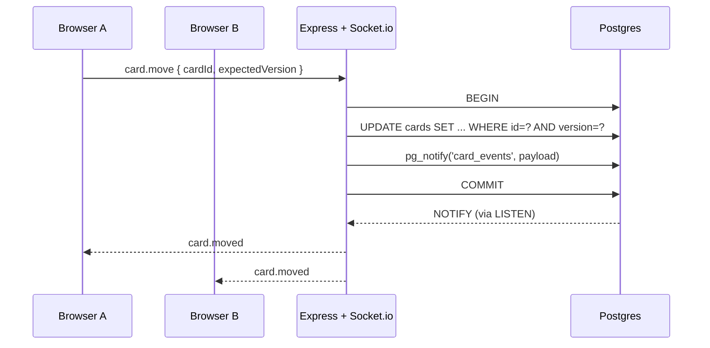

# Realtime Kanban

A collaborative Kanban board where multiple users rearrange cards simultaneously. Every drop fans out to every open tab within one network round-trip, with optimistic UI, server-authoritative conflict resolution, and a `LISTEN/NOTIFY`-based fan-out that keeps Redis out of the stack.

- **Live demo:** _(deploy in progress)_
- **Architecture:** [`docs/ARCHITECTURE.md`](docs/ARCHITECTURE.md)

## What's in it

- Drag cards within a column and across columns via `@dnd-kit`
- Optimistic UI with snapshot refetch on conflict — the server owns final order
- Concurrent moves resolved via optimistic locking (`version` column) plus a fractional-index retry loop that tightens the range on `P2002` collisions
- Realtime fan-out over Postgres `LISTEN/NOTIFY` — one less managed service
- Full type safety across the HTTP and WebSocket boundary via shared Zod schemas

## Stack

| Layer | Tech |
|---|---|
| Frontend | React 19, Vite 8, Zustand 5, `@dnd-kit`, Tailwind v4 |
| Backend | Node 22, Express 5, Socket.io 4, Prisma 6, Zod 4 |
| Database | Postgres (Neon free tier) |
| Realtime | Postgres `LISTEN/NOTIFY` → Socket.io rooms |
| Deploy | Vercel (web) + Koyeb (API) + Neon (DB) |

## Architecture at a glance



See [`docs/ARCHITECTURE.md`](docs/ARCHITECTURE.md) for the full decision log — database choice, fractional indexing, fan-out strategy, and the upgrade triggers for each.

## Running locally

Requires Node 22.12+ and pnpm 10+.

```bash
pnpm install

# API — add your Neon URLs to the env file, then migrate + seed
cp packages/api/.env.example packages/api/.env
# edit packages/api/.env with your DATABASE_URL and DIRECT_URL
pnpm --filter api exec prisma migrate deploy
pnpm --filter api db:seed

# Web
cp packages/web/.env.example packages/web/.env

# Start both — API on :3001, web on :5173
pnpm dev
```

## Project structure

```
packages/
├── shared/              Zod schemas + socket event contracts
├── api/
│   ├── prisma/          schema + migrations + seed
│   ├── scripts/         smoke tests (2-client concurrency verification)
│   └── src/
│       ├── db/          Prisma client + LISTEN/NOTIFY bridge
│       ├── services/    pure data operations (cards, boards)
│       ├── routes/      thin Express handlers
│       ├── sockets/     thin Socket.io handlers
│       └── middleware/  error translation + rate limit
└── web/
    └── src/
        ├── hooks/       useBoardSocket (owns connection + subscribe)
        ├── stores/      Zustand board store (idempotent event appliers)
        └── components/  Board / Column / Card / AddCardForm
```

## Smoke tests

The move handler is the project's critical path. Two concurrent-client smoke tests verify behavior under contention against a real Postgres:

```bash
# Create path: client A inserts 10 cards; client B must observe every one.
pnpm --filter api smoke:create

# Move path: both clients fire 20 concurrent moves. Every move either
# commits or returns a clean conflict; final state converges with zero
# divergence between the two clients' event-reconstructed views.
pnpm --filter api smoke:move
```

## License

MIT.
